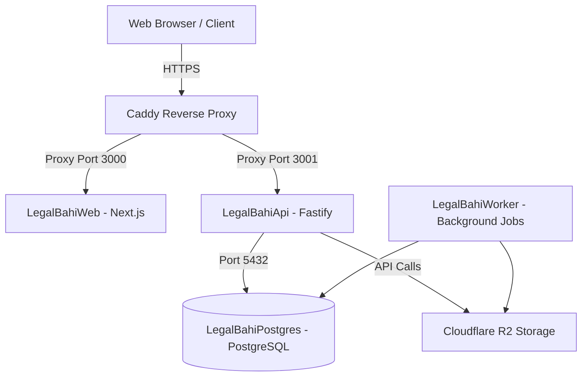

# Legal Bhai VPS Deployment & Troubleshooting Guide

This document serves as a complete reference for managing, deploying, and troubleshooting the **Legal Bhai** application stack on the Windows VPS Server (`64.235.61.6`).

---

## 1. System Architecture Overview

The VPS operates on Microsoft Windows Server with a self-contained service architecture managed via NSSM (Non-Sucking Service Manager) and Caddy.



### Key Services & Ports

| Service Name | Description | Port | Execution Command | Log File Location |
| :--- | :--- | :--- | :--- | :--- |
| `caddy` | HTTPS Edge Proxy & SSL termination | `80`, `443` | `caddy run` | System Event Logs / Caddy stdout |
| `LegalBahiPostgres` | PostgreSQL Local Database | `5432` | Postgres System Service | Postgres Data Logs |
| `LegalBahiApi` | Fastify REST API | `3001` | `node --import tsx src/server.ts` | `C:\LegalBahi\logs\LegalBahiApi.std*.log` |
| `LegalBahiWeb` | Next.js Production Server | `3000` | `npm run start` (workspace) | `C:\LegalBahi\logs\LegalBahiWeb.std*.log` |
| `LegalBahiWorker` | Notification, Backup, Scraper Worker | N/A | `node --import tsx src/worker.ts` | `C:\LegalBahi\logs\LegalBahiWorker.std*.log` |

---

## 2. Standard Deployment Workflows

Deployment is fully automated using scripts executed from your **local workspace**. Set your SSH password locally in PowerShell first:
```powershell
$env:VPS_SSH_PASSWORD="dec39f2f3696983f"
```

### Synchronize Source & Update Website
To push local changes, install dependencies, and rebuild the web bundle on the server, run:
```bash
npm run vps:sync:all
```
*What this script does:*
1. Connects to the VPS via SSH.
2. Stops NSSM services (`LegalBahiApi`, `LegalBahiWorker`, `LegalBahiWeb`).
3. Syncs code folders (`apps/api`, `apps/web`, `packages/shared`, `infra`).
4. Runs `npm install` on the server.
5. Invokes `infra/windows/build-web.ps1` to compile the Next.js bundle.
6. Restarts all three services.

### Restarting Services Manually
If you only need to reload environment variables or reboot the backend and worker processes:
```bash
npm run vps:restart-api
```

---

## 3. Database Management & Seeding

### Updating the Schema (Running Migrations)
When you add new `.sql` migrations under `infra/postgres/migrations`, they are applied automatically when the API starts up or by calling:
```bash
# Executed on the VPS
npm run migrate
```

### Seeding or Resetting Staging Data
If the Postgres database needs to be wiped and re-populated with the full investor demo dataset (lawyers, matters, alerts, documents, messages), run:
```bash
# Executed from your local machine
$env:VPS_SSH_PASSWORD="dec39f2f3696983f"; node scripts/vps-reseed.mjs
```
*What this script does on the VPS:*
1. Wipes the existing public schema `DROP SCHEMA public CASCADE; CREATE SCHEMA public;`.
2. Re-runs all schema migrations sequentially.
3. Imports the investor demo dataset from the seeded SQLite snapshots into PostgreSQL.
4. Uploads the mock documents (Vakalatnamas, court orders, plaints) to Cloudflare R2 bucket storage and maps the storage keys.
5. Prints the counts to verify everything populated.

---

## 4. Troubleshooting & Encountered Issues

### Issue 1: CORS Policy Preflight Blocks
* **Symptom**: Browser reports `No 'Access-Control-Allow-Origin' header is present on the requested resource` when fetching the API.
* **Troubleshooting Steps**:
  1. Inspect the dynamic CORS origins configuration in `apps/api/src/app.ts`. Ensure it handles the environment variables correctly.
  2. If the CORS error occurs on **specific routes** (e.g. `/v1/reports/overview`), verify if the endpoint is matching a "deferred product route" pattern inside the Fastify `onRequest` hook.
  3. *Root Cause*: Fastify's `onRequest` hook was intercepting requests to deferred paths like `/v1/reports` and returning a `404` *before* the CORS headers could be appended by the CORS plugin.
  4. *Resolution*: Update the hook condition to bypass blocking when `isInvestorStaging()` (investor staging mode) is enabled:
     ```typescript
     if (isProduction() && !isInvestorStaging() && DEFERRED_PRODUCT_ROUTE_PREFIXES.some(...)) {
       reply.code(404).send({ error: "Not found" });
       return;
     }
     ```

### Issue 2: Next.js Build Missing on Web Startup
* **Symptom**: `LegalBahiWeb` service enters a `Paused` or `Stopped` state. The stderr log logs: `Error: Could not find a production build in the '.next' directory. Try building your app with 'next build'`.
* **Troubleshooting Steps**:
  1. This occurs because the deployment script deletes the old `.next` folder during cleanup, and the web build was either skipped or crashed.
  2. Rebuild Next.js directly on the VPS by running:
     ```powershell
     # Executed on the VPS under C:\LegalBahi
     .\infra\windows\build-web.ps1 -Root "C:\LegalBahi" -EnvironmentFile "C:\LegalBahi\.env.production"
     ```
  3. Once the compilation completes successfully, restart the web service:
     ```powershell
     # Executed on the VPS
     C:\LegalBahi\tools\nssm.exe stop LegalBahiWeb
     C:\LegalBahi\tools\nssm.exe start LegalBahiWeb
     ```

### Issue 3: Port Collision / EADDRINUSE 3001
* **Symptom**: API stderr logs show `Error: listen EADDRINUSE: address already in use 127.0.0.1:3001`.
* **Troubleshooting Steps**:
  1. A previous Node process is hanging or didn't shut down correctly, holding port 3001.
  2. Stop the service first:
     ```powershell
     C:\LegalBahi\tools\nssm.exe stop LegalBahiApi
     ```
  3. If it remains locked, locate and kill the process holding port 3001:
     ```powershell
     # Find the PID
     netstat -aon | findstr ":3001"
     # Kill the PID (e.g., 8124)
     taskkill /F /PID 8124
     ```
  4. Restart the service:
     ```powershell
     C:\LegalBahi\tools\nssm.exe start LegalBahiApi
     ```

---

## 5. System Status Verification Command
You can run a complete E2E diagnostics verify script locally to verify services, public health, HTTPS, and CORS preflight response codes:
```bash
$env:VPS_SSH_PASSWORD="dec39f2f3696983f"; node scripts/vps-final-verify.mjs
```
All outputs should return `HTTP_STATUS:200` or `204` with no CORS failures.
