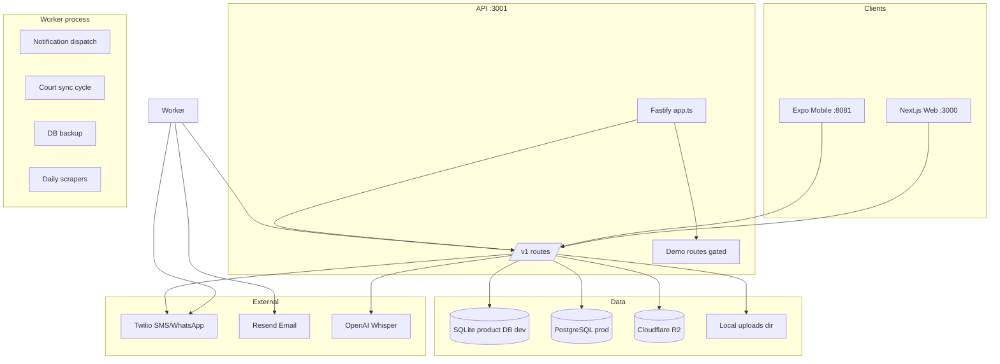

# LegalBahi — Complete Project Record

> **Last updated:** June 2026  
> **Monorepo:** `LEGALBAHI` (`legalbahi` npm workspace)  
> **Product:** Invite-only legal practice platform for solo lawyers and their clients in Islamabad / Rawalpindi.

This document records what has been built, how the frontend and backend fit together, every major route and page, transitions, auth, data flows, and where to find code. For deployment and disaster recovery, see also [`Docs/DEPLOYMENT.md`](Docs/DEPLOYMENT.md) and [`Docs/RESTORE.md`](Docs/RESTORE.md).

---

## Table of contents

1. [Executive summary](#1-executive-summary)
2. [Monorepo layout](#2-monorepo-layout)
3. [Local development](#3-local-development)
4. [Work completed to date](#4-work-completed-to-date)
5. [Architecture overview](#5-architecture-overview)
6. [Backend (API)](#6-backend-api)
7. [Background worker](#7-background-worker)
8. [Web frontend](#8-web-frontend)
9. [Mobile app](#9-mobile-app)
10. [Shared packages](#10-shared-packages)
11. [Infrastructure & deployment](#11-infrastructure--deployment)
12. [CI / verification](#12-ci--verification)
13. [Environment variables](#13-environment-variables)
14. [Key file index](#14-key-file-index)

---

## 1. Executive summary

LegalBahi is a **pnpm/npm workspaces monorepo** with three runnable apps:

| App | Package | Stack | Default port |
|-----|---------|-------|--------------|
| **API** | `@wakeel/api` | Fastify, SQLite (dev) / PostgreSQL (prod) | `3001` |
| **Web** | `@wakeel/web` | Next.js 16 App Router, React 19 | `3000` |
| **Mobile** | `@wakeel/mobile` | Expo 54, React Native 0.81 | `8081` (Metro) |

**Core capabilities:**

- Lawyer/staff OTP login, firm workspace, matter & client management
- Court cause-list ingestion (IHC, LHC Rawalpindi, district courts), calendar, conflict detection
- Hearing capture, document vault, OCR, malware scanning on upload
- Client portal (OTP) with multi-matter access, hearings, documents, chat
- Token-based shared portal links (`/c/[token]`) with separate portal OTP
- SMS / WhatsApp / email notification worker (Twilio + Resend in production)
- Mobile offline queue for hearing mutations (SQLite via `expo-sqlite`)

**Auth in development:** fixed OTP from `WAKEEL_DEV_OTP_CODE` (default `246810`).  
**Seed logins:** lawyer `03001234567`, client `03005550001`.

---

## 2. Monorepo layout

```
LEGALBAHI/
├── apps/
│   ├── api/          # Fastify HTTP API + worker entrypoints
│   ├── web/          # Next.js web app
│   └── mobile/       # Expo React Native app
├── packages/
│   └── shared/       # Shared types, palette, demo constants
├── infra/
│   ├── postgres/migrations/   # SQL migrations for production DB
│   ├── windows/               # PowerShell deploy, backup, Caddy scripts
│   └── r2/                    # R2 lifecycle config
├── scripts/          # Repo lint, VPS sync, mobile flow verification
├── Docs/             # DEPLOYMENT.md, RESTORE.md
├── e2e/              # Playwright tests (web)
├── package.json      # Root workspace scripts
├── README.md         # Quick start
└── PROJECT_RECORD.md # This file
```

---

## 3. Local development

```powershell
npm install

# Terminal 1 — API
$env:NODE_ENV='development'
npm run dev:api

# Terminal 2 — Web
npm run dev:web

# Terminal 3 — Mobile (Expo)
npm run dev:mobile
```

| URL | Purpose |
|-----|---------|
| http://localhost:3000 | Web app |
| http://localhost:3001 | API |
| http://localhost:8081 | Metro bundler (Expo Go) |

Copy `.env.example` → `.env` at repo root (API reads env from project).

**Reseed demo product data:**

```bash
npm run reset:demo
```

Stop the API first if SQLite reports `database is locked`.

**Full verification:**

```bash
npx playwright install chromium
npm run verify
```

---

## 4. Work completed to date

### 4.1 Core product (backend + web + mobile)

- **Product API (`/v1/*`)** — full CRUD for firms, matters, clients, hearings, documents, threads, calendar, court sync, portal, billing stubs, search, alerts, notifications
- **Dual database strategy** — SQLite `ProductStore` for dev/test; `PostgresProductStore` for production
- **JWT sessions** — 15-minute access tokens, 30-day refresh tokens, session revocation on logout
- **OTP auth** — staff login/register, client login, portal OTP; dev mock code; production Twilio SMS
- **Document pipeline** — multipart upload, magic-byte validation, optional malware scan, local or Cloudflare R2 storage, OCR on PDFs/images
- **Court ingestion** — automated cause-list fetch + matter matching for pilot courts
- **Notification worker** — scheduled SMS/WhatsApp/email jobs (hearing reminders, next-day agenda, post-hearing updates, portal access)
- **Database backups** — scheduled pg_dump / SQLite backup to encrypted R2
- **Staff web workspace** — overview, matters, calendar, alerts, clients, vault, settings, onboarding
- **Client web portal** — multi-matter sidebar, timeline, hearings/documents/chat tabs
- **Mobile parity** — lawyer tabs + client portal with matter switcher, document upload/share, chat
- **Playwright E2E** — pilot workflow against local stack
- **CI pipeline** — API tests on Postgres, web build, E2E, mobile typecheck, Expo export, dump/restore check

### 4.2 Authentication & security hardening

- Request body JSON schemas + structured validation errors on API routes
- XSS input sanitization on sensitive fields
- Rate limiting (sliding window) on OTP and general routes
- Production env validation (`validateProductionEnvironment`) — rejects demo surfaces, requires Twilio/Resend/R2/Postgres
- OTP failure trace logging + Sentry `captureError`
- Uptime health endpoint (`GET /v1/health/uptime`) for external monitoring
- Removed temporary US phone / trial credential scaffolding; Pakistan `+92` normalization throughout

### 4.3 Client portal architecture (web + mobile)

- Clients see **all matters** linked to their `clientId` (not one matter per token)
- `GET /v1/clients/me/matters` + `GET /v1/clients/me/matters/:id` power authenticated client workspace
- Portal link flow: `POST /v1/portal/otp` → verify → `GET /v1/portal/cases` with scoped JWT
- Mobile: horizontal **Shared Matters** pill switcher, timeline/hearings/documents/chat tabs
- Mobile document open: `File.downloadFileAsync` + `expo-sharing` (Expo 54)

### 4.4 Demo / seed data

- Firm: **Hassan & Co. Law Associates** (`firm-hassan-co`)
- Staff: Salman Hassan (owner `03001234567`), Sana Malik (lawyer), Hamza Sheikh (assistant)
- Client: **Ahmed Zubair** (`03005550001`, `client-redtone`)
- Matters: `matter-redtone` (W.P. 2076/2019, IHC), `matter-farooq` (Civil Suit 45/2025)
- High-fidelity seed PDFs/DOCX and hearing-order PNG assets
- Hearings seeded for Aug 2026 demo dates

### 4.5 Web UX polish (recent)

- **Login OTP crossfade** — `.auth-flow-stack` / `.auth-flow-panel` opacity + translate transitions between phone and OTP steps; auto-focus first OTP digit after request
- **Client workspace header** — removed sidebar “Client Workspace” profile box; client name (green gradient `.title`), firm name, and formatted phone in top bar
- **Matter timeline meta** — responsive flex layout for Court / Stage / Next Hearing (tight row spacing)
- **Hearings tab** — full-width `.hearing` timeline cards with left border + dot marker
- **Workspace content fade** — `.workspace-content-fade` on matter/tab switch in client portal
- **Active matter cards** — `.client-case-card.active` / `.inactive` emerald styling in sidebar
- **Responsive OTP digit row** — `.otp-digit-row` / `.otp-digit-input` scales on narrow viewports
- **Login spacing** — reduced gap between phone field and Request OTP button

### 4.6 Legacy demo API (optional)

When `ENABLE_DEMO_SURFACES=true`, the original prototype API (`/cases`, `/auth/demo/*`, IHC live sync demo) is exposed from `apps/api/src/app.ts`. **Disabled in production.**

---

## 5. Architecture overview



**Request flow (typical authenticated call):**

1. Web/mobile reads JWT from `localStorage` (web) or `expo-secure-store` (mobile)
2. `productJsonRequest` / `apiRequest` attaches `Authorization: Bearer <token>`
3. API `createProductRouteContext()` verifies JWT, resolves actor + firm
4. Route handler calls `ProductStore` / `PostgresProductStore` method
5. On `401`, client calls `POST /v1/auth/refresh` and retries once

---

## 6. Backend (API)

**Package:** `apps/api`  
**Entry points:**

| File | npm script | Role |
|------|------------|------|
| `src/server.ts` | `dev`, `start` | HTTP server (`PORT` default 3001) |
| `src/worker.ts` | `worker` | Background jobs (separate process in prod) |
| `src/migrate.ts` | `migrate` | Apply Postgres migrations |
| `src/reset.ts` | `reset:demo` | Wipe + reseed SQLite demo data |
| `src/production-smoke.ts` | `smoke:production` | Production health checks |

**App assembly:** `src/app.ts` → `buildServer()` registers health routes, optional demo routes, then `registerProductRoutes()` from `src/lib/product-api.ts`.

### 6.1 Route modules

Routes live under `apps/api/src/routes/` and are registered from `lib/product-api.ts`:

| Module | Prefix / paths | Responsibility |
|--------|----------------|----------------|
| `health.ts` | `GET /v1/health/uptime` | External uptime probe (Bearer `UPTIME_SECRET`) |
| `auth.ts` | `/v1/auth/*`, `/auth/*` legacy aliases | OTP request/verify, register, refresh, logout, `/v1/me`, sessions, pilot invites |
| `firms.ts` | `/v1/firms/*`, memberships, invitations, `/v1/roles` | Firm CRUD, staff invites, permissions |
| `matters.ts` | `/v1/matters/*` | Matter CRUD, parties, CSV import preview/confirm |
| `hearings.ts` | `/v1/matters/:id/hearings`, `/v1/upload/audio`, `/v1/calendar*` | Hearings, Whisper audio → hearing, calendar + conflicts |
| `documents.ts` | `/v1/documents/*`, `/v1/threads/*` | Document upload/metadata/download, messaging threads |
| `clients.ts` | `/v1/clients/*`, `/v1/clients/me/matters*` | Client CRUD, client self-service matters, matter sharing |
| `billing.ts` | `/v1/time-entries`, `/v1/invoices` | Time tracking + invoicing (deferred in prod UI) |
| `court.ts` | `/v1/court-sources/*`, `/v1/court-matches/*` | Cause-list sync, match review, manual linking |
| `reports.ts` | `/v1/search`, `/v1/reports/*`, `/v1/alerts/*`, `/v1/notifications/*` | Search, overview report, alerts, notification prefs/history |
| `portal.ts` | `/v1/portal/*` | Portal link creation, case list/detail, portal OTP |
| `webhooks.ts` | `/v1/ingestion-runs` | Ingestion run history |

**Health (non-versioned):** `GET /health`, `GET /health/ready` in `app.ts`.

### 6.2 Auth & OTP (`routes/context.ts`, `routes/auth.ts`, `lib/auth.ts`)

| Concern | Implementation |
|---------|----------------|
| Access token | JWT, 15 min TTL, claims: `actorType`, `actorId`, `firmId`, `sid`, optional `portalLinkId` |
| Refresh token | 30 days, rotated on `POST /v1/auth/refresh` |
| Dev OTP | `NODE_ENV !== 'production'` → code from `WAKEEL_DEV_OTP_CODE`, returned as `devCode` |
| Prod OTP | Random 6-digit, SHA-256 hashed in `otp_requests`, sent via Twilio SMS |
| Staff register | Requires pilot invite; creates firm + owner membership |
| Client login | Silent success if phone unknown (`expiresAt: null`) — anti-enumeration |
| Portal OTP | Scoped to portal link; JWT includes `portalLinkId`, no refresh token |

**Token verification:** `verifyAppToken()` in `lib/auth.ts` on every protected route.

### 6.3 Data layer

| Component | Path | When used |
|-----------|------|-----------|
| Runtime selector | `lib/runtime-product-store.ts` | Picks SQLite vs Postgres |
| SQLite store | `lib/product-store.ts` + `store/sqlite/*.ts` | Dev, test, `reset:demo` |
| Postgres store | `lib/postgres-product-store.ts` | Production or `USE_POSTGRES_PRODUCT_STORE=true` |
| Demo store | `lib/store.ts` | Legacy demo only (`ENABLE_DEMO_SURFACES`) |
| Migrations | `infra/postgres/migrations/*.sql` | Applied via `npm run migrate` |
| File sync export | `lib/file-sync.ts` | JSON snapshots to `data/store-files/` after seed |

**Object storage** (`lib/storage.ts`):

- **Dev:** `local:{filename}` in `data/product-uploads/`
- **Prod:** `r2:private/documents/...` on Cloudflare R2

**Upload security** (`lib/file-validation.ts`, `lib/malware-scan.ts`):

- Magic-byte + extension checks
- Optional ClamAV / Cloudmersive / VirusTotal scan (`MALWARE_SCAN_PROVIDER`)

### 6.4 Key backend libraries

| File | Purpose |
|------|---------|
| `lib/config.ts` | Env loading, `isProduction()`, JWT secret, prod validation |
| `lib/providers.ts` | Twilio SMS/WhatsApp, Resend email, WhatsApp→SMS failover |
| `lib/notification-schedule.ts` | Template rendering, PKT scheduling |
| `lib/court-sources.ts` | Court catalog + ingestion orchestration |
| `lib/court-fetch.ts`, `court-html.ts` | HTML cause-list parsing |
| `lib/ihc.ts`, `lhc-rawalpindi.ts`, `rwp-district.ts` | Court-specific fetchers |
| `lib/transcription.ts` | OpenAI Whisper for `/v1/upload/audio` |
| `lib/ocr.ts` | PDF/image text extraction |
| `lib/csv-import.ts` | Matter CSV validation |
| `lib/database-backup.ts`, `backup-storage.ts` | Encrypted backups to R2 |
| `lib/input-sanitizer.ts` | XSS sanitization |
| `lib/validation.ts` | Pakistan phone normalization (`normalizePakistanPhone`) |
| `lib/route-schemas.ts` | Fastify JSON schemas |
| `lib/rate-limit.ts` | Sliding window rate limiter |
| `lib/telemetry.ts` | Sentry initialization + error capture |
| `lib/fastify-server.ts` | Fastify factory + validation error handler |

### 6.5 Seed data reference

Enabled when `NODE_ENV=test`, `WAKEEL_TESTING=true`, or `ENABLE_PRODUCT_SEED_DATA=true`.

| Entity | ID / phone | Notes |
|--------|------------|-------|
| Firm | `firm-hassan-co` | Hassan & Co. Law Associates, Islamabad |
| Owner | `03001234567` | Advocate Salman Hassan |
| Lawyer | `03007654321` | Sana Malik |
| Assistant | `03001112222` | Hamza Sheikh |
| Client | `03005550001` | Ahmed Zubair |
| Matter 1 | `matter-redtone` | W.P. 2076/2019, IHC |
| Matter 2 | `matter-farooq` | Civil Suit 45/2025, RWP district |

Notification templates seeded: `lawyer_next_day_agenda`, `client_hearing_reminder`, `post_hearing_update`, `portal_access_token`.

---

## 7. Background worker

**File:** `apps/api/src/worker.ts`  
**Run:** `npm --workspace @wakeel/api run worker` (separate from HTTP server in production)

| Cycle | Interval | Function |
|-------|----------|----------|
| Notifications | 60s | Claim due `notification_jobs` → render template → dispatch SMS/WhatsApp/email |
| Court sync | `COURT_SYNC_INTERVAL_MINUTES` (default 1) | Fetch + ingest cause lists per `COURT_SOURCE_DEFINITIONS` |
| DB backup | `BACKUP_CHECK_INTERVAL_MINUTES` (default 60) | pg_dump or SQLite → gzip → age-encrypted R2 upload |
| Daily scraper | 60s tick, runs ~01:00 PKT | LHC + district court scrapers |

Worker calls `validateProductionEnvironment()` on startup and closes the DB store on SIGINT/SIGTERM.

---

## 8. Web frontend

**Package:** `apps/web`  
**Framework:** Next.js 16 App Router, React 19  
**Global styles:** `apps/web/app/globals.css`  
**API client:** `apps/web/lib/product-api.ts`

### 8.1 Routing model

There is **no active `middleware.ts`**. Routing uses:

- **Next.js rewrites** in `next.config.mjs` — friendly staff URLs → `/product/staff`
- **Next.js redirects** — `/dashboard` → `/product/staff`, `/cases` → `/matters`
- **Client-side section resolution** on staff page via `usePathname()`
- **Re-export shims** for client routes

| Public URL | Rendered by | What it shows |
|------------|-------------|---------------|
| `/` | `app/page.tsx` | Split login: Lawyer Portal + Client Portal (OTP) |
| `/overview` | `app/product/staff/page.tsx` | Staff workspace — Overview section |
| `/matters`, `/matters/:id` | same | Matters list + detail deep-link |
| `/calendar` | same | Calendar section |
| `/alerts` | same | Alerts section |
| `/clients` | same | Client management |
| `/vault` | same | Document vault |
| `/settings` | same | Workspace settings + team |
| `/onboarding` | same | Onboarding checklist (inline in staff page) |
| `/billing`, `/team`, `/reports` | same | URL resolves but **no dedicated UI branch yet** |
| `/client` | `app/client/page.tsx` → `product/client/page.tsx` | Authenticated client portal |
| `/c/[token]` | `app/c/[token]/page.tsx` → `product/client/page.tsx` | Token portal (OTP gate) |
| `/product` | `app/product/page.tsx` | Dev hub linking to staff + client |

**Staff navigation:** `Sidebar.tsx` uses `<Link href={item.href}>`; each URL rewrite loads the same `ProductStaffPage`, which calls `resolveSection(pathname)` to pick the active section.

**Client sub-tabs** (hearings / documents / chat) are **React state only** (`activeSubTab`) — URL stays `/client` or `/c/[token]`.

### 8.2 Page-by-page breakdown

#### `app/page.tsx` — Login

**Layout:** `brand-hero-panel` (marketing) + `login-form-panel` (auth card).

**Lawyer tab:**

1. Phone input (PK +92 prefix)
2. Optional registration mode: name, firm, email, city
3. `POST /v1/auth/otp/request` (`actorType: "staff"`, `purpose: "login"|"register"`)
4. OTP panel crossfades in; first digit auto-focused
5. Verify → `POST /v1/auth/otp/verify` or `POST /v1/auth/staff/register`
6. Saves `legalbahi-staff-auth` → `router.replace("/overview")`

**Client tab:**

1. Phone → `POST /v1/auth/otp/request` (`actorType: "client"`)
2. If `expiresAt === null` → “Client account not found”
3. Verify → `POST /v1/auth/otp/verify`
4. Saves `legalbahi-client-auth` → `router.replace("/client")`

**On mount:** redirects if tokens already in localStorage.

#### `app/product/staff/page.tsx` — Staff workspace (~1,700 lines)

**Auth:** `legalbahi-staff-auth` in localStorage; guard redirects to `/` if missing.

**Sections** (conditional render by `activeSection`):

| Section | Component | Main features |
|---------|-----------|---------------|
| `overview` | `OverviewSection.tsx` | Stats, priority alerts, court health, recent threads |
| `matters` | `MattersSection.tsx` | Matter list/detail, hearings, documents, portal links, hearing capture form |
| `calendar` | `CalendarSection.tsx` | Upcoming listings, conflicts |
| `alerts` | `AlertsSection.tsx` | Alert history, mark read |
| `clients` | `ClientsSection.tsx` | Create/search clients, SMS consent, linked matters |
| `vault` | `VaultSection.tsx` | Firm-wide documents, portal visibility toggle |
| `settings` | `SettingsSection.tsx` | Profile, notification prefs, staff invites |
| `onboarding` | inline JSX | Setup checklist with links to matters/settings/clients |

**Key functions in staff page:** `authedRequest`, `loadWorkspace`, `openMatter`, `signOut`, `saveHearing`, `uploadDocument`, `sendMessage`, `createPortalLink`, etc.

**Matter deep links:** `resolveMatterId(pathname)` reads `/matters/:id` and opens that matter in `MattersSection`.

#### `app/product/client/page.tsx` — Client workspace (~1,100 lines)

**Two modes:**

1. **Authenticated (`/client`)** — `legalbahi-client-auth`, full client API
2. **Portal token (`/c/[token]` or `?token=`)** — `portalAuth` JWT after portal OTP

**Layout (authenticated):**

```
top-bar
  └── h1.title (client name)
  └── firm name (muted)
  └── phone (formatted via formatPakistanDisplayPhone)
  └── Sign Out

dashboard-grid (380px sidebar + main)
  ├── ClientSidebar — Shared Matters list only (+ portal OTP when token mode)
  └── main column
        ├── MatterTimelineHeader — case number, title, court/stage/next hearing
        ├── workspace-content-fade wrapper
        │     ├── sub-tab buttons (Hearings | Shared Documents | Chat)
        │     ├── HearingsTab | DocumentsTab | ChatTab
        ├── DocumentViewerModal
        └── upload category modal (inline)
```

**Key API calls:**

| Action | Endpoint |
|--------|----------|
| Profile | `GET /v1/me` |
| Matter list | `GET /v1/clients/me/matters` |
| Matter detail | `GET /v1/clients/me/matters/:id` |
| Send message | `POST /v1/threads/:id/messages` |
| Upload document | `POST /v1/documents` (FormData) |
| Download | `GET /v1/documents/:id/download` |
| Portal OTP | `POST /v1/portal/otp`, `POST /v1/portal/otp/verify` |
| Portal matters | `GET /v1/portal/cases`, `GET /v1/portal/cases/:id` |

**Key state/functions:** `loadWorkspace`, `openMatter`, `openPortalMatter`, `sendMessage`, `openDocument`, `signOut`, `workspaceContentVisible` fade effect on matter/tab change.

#### Client sub-components

| File | Role |
|------|------|
| `ClientSidebar.tsx` | Shared Matters cards; portal OTP slot |
| `PortalOtpPrompt.tsx` | Portal OTP request + 6-digit verify UI |
| `MatterTimelineHeader.tsx` | Matter summary header panel |
| `HearingsTab.tsx` | Hearing timeline list |
| `DocumentsTab.tsx` | Shared documents + upload trigger |
| `ChatTab.tsx` | Message thread UI |
| `DocumentViewerModal.tsx` | PDF/image viewer modal (shared with staff) |
| `helpers.ts` | `formatPakistanDisplayPhone`, `formatCourtId`, `formatDateTime`, `toTitleCase` |

### 8.3 Auth storage (web)

| Key | Used by | Shape |
|-----|---------|-------|
| `legalbahi-staff-auth` | Login, staff page | `{ token, refreshToken }` |
| `legalbahi-client-auth` | Login, client page | `{ token, refreshToken }` |

Helpers: `readStoredProductAuth`, `writeStoredProductAuth`, `refreshProductAuth` in `lib/product-api.ts`.

### 8.4 Transitions & animations (`globals.css`)

#### Login auth flow

| Class | Behavior |
|-------|----------|
| `.auth-flow-stack` | Relative container for stacked panels |
| `.auth-flow-stack--otp` | Min-height when OTP panel visible |
| `.auth-flow-panel` | `opacity` + `transform` transition (~250ms ease-out) |
| `.auth-flow-panel--visible` | Fully visible, `translateY(0)` |
| `.auth-flow-panel--hidden` | Faded out, `translateY(6px)`, `position: absolute`, no pointer events |
| `.auth-flow-panel .field` | Tighter `margin-bottom: 8px` on login fields |
| `.otp-digit-row` / `.otp-digit-input` | Responsive flex OTP boxes |

**Mechanism:** Phone step and OTP step are sibling panels inside `.auth-flow-stack`. Toggling `otpRequested` swaps `--visible` / `--hidden` classes for crossfade. Primary action button sits below the stack.

#### Client portal

| Class | Behavior |
|-------|----------|
| `.workspace-content-fade` | Opacity transition on tab/matter content (~250ms) |
| `.workspace-content-fade--hidden` | `opacity: 0` during matter/tab switch |
| `.client-case-card` | 450ms transitions; `.active` emerald highlight, `.inactive` neutral |
| `.matter-timeline-meta` | Flex column, 2px gap between Court/Stage/Next Hearing rows |
| `.hearing` / `.hearing-card` | Left-border timeline cards with dot marker |

**Matter switch fade:** `useEffect` on `[selectedMatter?.id, activeSubTab]` sets `workspaceContentVisible` false, then true after ~400ms timeout.

#### Global UI

| Element | Transition |
|---------|------------|
| Buttons, inputs | `all 0.2s ease` |
| `.panel`, `.case-card`, `.modal-card` | transform + box-shadow 0.2s |
| `.modal-backdrop` | `fadeIn 0.2s` |
| `.modal-card` | `modalPop 0.3s` spring |

**Staff section changes:** instant conditional mount — no page-level transition between `/overview` and `/matters`.

### 8.5 Navigation summary

| From | To | How |
|------|-----|-----|
| Login (staff OTP ok) | `/overview` | `router.replace` |
| Login (client OTP ok) | `/client` | `router.replace` |
| Staff (no auth) | `/` | `useEffect` guard |
| Client (no auth, no token) | `/` | `useEffect` guard |
| Sidebar link | `/matters`, etc. | `<Link>` — URL change, same page component |
| Open matter (staff) | `/matters/:id` | `router.replace` |
| Client matter pick | — | State only (`openMatter`) |
| Login phone ↔ OTP | — | CSS panel crossfade + optional opacity utilities |

---

## 9. Mobile app

**Package:** `apps/mobile`  
**Entry:** `index.js` → `App.tsx` → `src/productApp.tsx` (~4,000 lines, monolithic)

### 9.1 Structure

| File | Role |
|------|------|
| `src/productApp.tsx` | All screens, state, API wrappers, UI |
| `src/api.ts` | `apiRequest`, base URL resolution (localhost → emulator/device IP) |
| `src/theme.ts` | Design tokens |
| `src/offline/database.ts` | expo-sqlite schema |
| `src/offline/queue.ts` | `enqueueMutation`, `listPendingMutations` |
| `src/offline/sync-agent.ts` | `flushOfflineQueue`, 15s interval + AppState resume |

**No React Navigation** — screens are early returns inside `ProductApp`:

1. Client authenticated → client portal UI
2. Not staff auth → login screen
3. `selectedMatter` set → matter detail
4. Else → staff dashboard with bottom tabs

### 9.2 Staff (lawyer) UI

**Bottom tabs:** `overview` | `matters` | `calendar` | `alerts`

| Tab | Content |
|-----|---------|
| Overview | Stats, alerts, court health, offline queue banner, recent threads |
| Matters | Matter list → full-screen matter detail |
| Calendar | Upcoming listings |
| Alerts | Full alert feed |

**Matter detail:** metadata, hearing timeline, documents, client chat, **Capture hearing** form (multipart upload).

**Modals (Options menu):** Clients management, Vault, Settings/team.

### 9.3 Client portal UI

**Sub-tabs:** `hearings` | `documents` | `chat`

- Header: client name, firm, phone, sign out
- Horizontal **Shared Matters** pills
- Hearings: matter overview + timeline
- Documents: categorized upload (camera/gallery/file), filter, download/share
- Chat: inverted message list

**Auth storage:** `expo-secure-store` keys `legalbahi-mobile-auth` (staff) and `legalbahi-mobile-client-auth` (client). Staff and client sessions are mutually exclusive at login.

### 9.4 Offline queue

When the device is offline, hearing mutations can be queued in SQLite (`pending_mutations`). `startOfflineSyncAgent` replays them every 15 seconds and when the app returns to foreground.

### 9.5 Mobile dependencies (high level)

Expo 54, React Native 0.81, `expo-secure-store`, `expo-file-system`, `expo-sharing`, `expo-image-picker`, `expo-document-picker`, `expo-sqlite`, `expo-camera` (via flows).

---

## 10. Shared packages

**Package:** `@wakeel/shared` (`packages/shared`)

| Export source | Contents |
|---------------|----------|
| `src/index.ts` | Legacy demo types (`CaseRecord`, `HearingLog`), `PALETTE`, `DEMO_CODE`, `DEMO_PHONES` |
| `src/product.ts` | Product domain constants (`PRODUCT_DOCUMENT_TYPES`, `PRODUCT_ACTOR_TYPES`, firm/matter interfaces) |

**Usage:** Web transpiles `@wakeel/shared` via `next.config.mjs`. Mobile does not import it (types duplicated locally in `productApp.tsx`). API uses its own store types.

---

## 11. Infrastructure & deployment

| Path | Purpose |
|------|---------|
| `infra/postgres/migrations/` | Versioned SQL schema (001–006+) |
| `infra/windows/Caddyfile` | Reverse proxy TLS termination |
| `infra/windows/build-web.ps1` | Production web build |
| `infra/windows/migrate-postgres.ps1` | Run migrations on VPS |
| `infra/windows/backup-postgres.ps1` | Manual backup script |
| `infra/windows/install-services.ps1` | Windows service installation |
| `infra/windows/run-production-smoke.ps1` | Smoke test wrapper |
| `infra/r2/lifecycle.json` | R2 object lifecycle rules |
| `scripts/vps-sync-api.mjs` | Deploy API to VPS |

**Production stack:** Caddy → Next.js static/server + Fastify API on loopback; separate worker process; PostgreSQL; Cloudflare R2 for documents and backups.

See [`Docs/DEPLOYMENT.md`](Docs/DEPLOYMENT.md) for full operator steps.

---

## 12. CI / verification

**Workflow:** `.github/workflows/ci.yml` (on push/PR to `main`)

Runs: `npm ci` → audit → migrate (twice, idempotency) → API tests → API typecheck → web build → Playwright E2E → mobile typecheck → mobile flow scripts → deployment asset check → Expo Android export → Postgres dump/restore test.

**Other workflows:**

- `.github/workflows/production.yml` — production deploy pipeline
- `.github/workflows/uptime.yml` — external uptime checks

**Root scripts:**

| Script | Command |
|--------|---------|
| `npm run verify` | Full local CI equivalent |
| `npm run test:api` | API unit/integration tests |
| `npm run test:web:e2e` | Playwright |
| `npm run test:mobile:flows` | Mobile flow verification script |
| `npm run smoke:production` | Production smoke tests |

---

## 13. Environment variables

Copy from `.env.example`. Critical variables:

| Variable | Purpose |
|----------|---------|
| `NODE_ENV` | `production` enables strict mode |
| `PORT`, `HOST` | API bind |
| `JWT_SECRET` | Token signing (≥32 chars prod) |
| `NEXT_PUBLIC_API_URL` | Web → API base URL |
| `EXPO_PUBLIC_API_URL` | Mobile → API base URL |
| `WAKEEL_DEV_OTP_CODE` | Fixed OTP in dev (default `246810`) |
| `DATABASE_URL` | Postgres (required prod) |
| `ENABLE_DEMO_SURFACES` | Legacy demo API (must be false prod) |
| `ENABLE_PRODUCT_SEED_DATA` | SQLite seed (must be false prod) |
| `TWILIO_*` | SMS + WhatsApp |
| `RESEND_*` | Email |
| `R2_*` | Document + backup storage |
| `OPENAI_API_KEY` | Whisper transcription |
| `SENTRY_DSN` | Error reporting |
| `UPTIME_SECRET` | Uptime endpoint auth |
| `CORS_ORIGINS`, `PUBLIC_WEB_URL`, `PUBLIC_API_URL` | Production URLs |

Full list validated in `apps/api/src/lib/config.ts` → `validateProductionEnvironment()`.

---

## 14. Key file index

### API

```
apps/api/src/server.ts
apps/api/src/worker.ts
apps/api/src/app.ts
apps/api/src/lib/product-api.ts
apps/api/src/lib/product-store.ts
apps/api/src/lib/postgres-product-store.ts
apps/api/src/lib/runtime-product-store.ts
apps/api/src/routes/{auth,matters,hearings,documents,clients,portal,court,firms,billing,reports,health,webhooks}.ts
apps/api/src/routes/context.ts
```

### Web

```
apps/web/app/page.tsx
apps/web/app/layout.tsx
apps/web/app/globals.css
apps/web/app/product/staff/page.tsx
apps/web/app/product/staff/components/*.tsx
apps/web/app/product/client/page.tsx
apps/web/app/product/client/components/*.tsx
apps/web/lib/product-api.ts
apps/web/next.config.mjs
apps/web/e2e/pilot-workflow.spec.ts
```

### Mobile

```
apps/mobile/App.tsx
apps/mobile/src/productApp.tsx
apps/mobile/src/api.ts
apps/mobile/src/offline/{database,queue,sync-agent}.ts
apps/mobile/app.json
apps/mobile/metro.config.js
```

### Shared & infra

```
packages/shared/src/{index,product}.ts
infra/postgres/migrations/*.sql
infra/windows/*.ps1
.github/workflows/*.yml
```

---

## Quick reference — demo logins

| Role | Phone | OTP (dev) |
|------|-------|-----------|
| Lawyer (owner) | `03001234567` | `246810` |
| Lawyer | `03007654321` | `246810` |
| Assistant | `03001112222` | `246810` |
| Client (Ahmed Zubair) | `03005550001` | `246810` |

---

*This document is a living record. Update it when adding routes, pages, or major architectural changes.*
